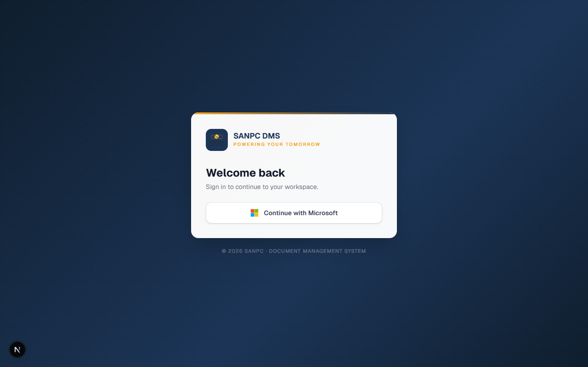
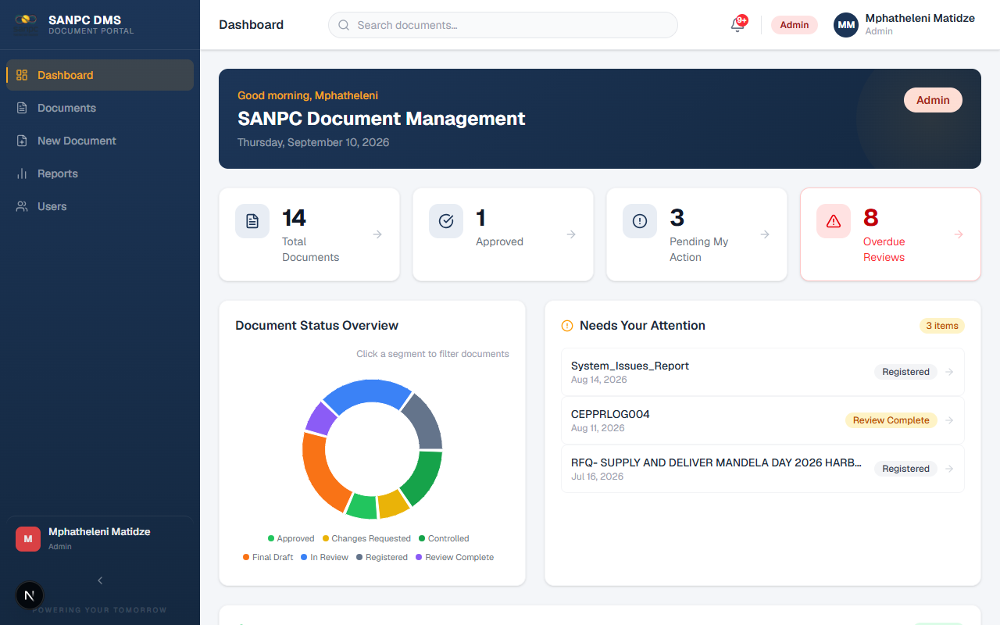
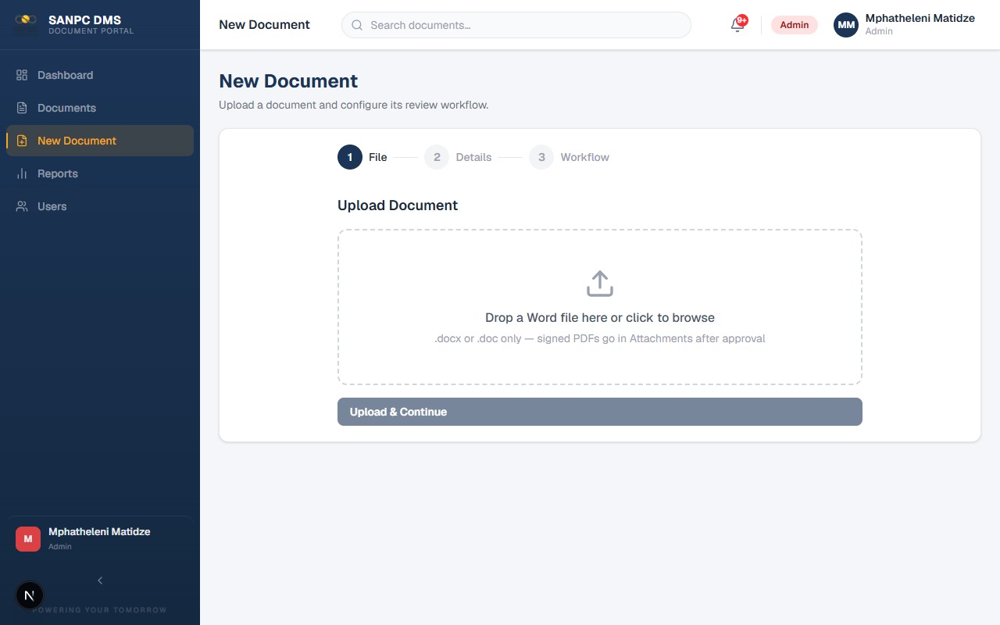
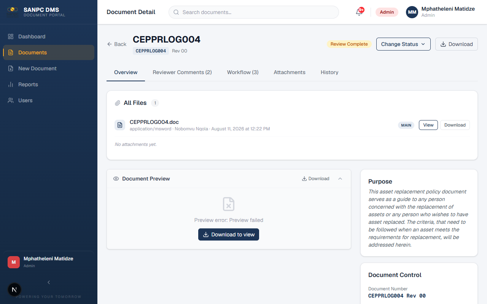
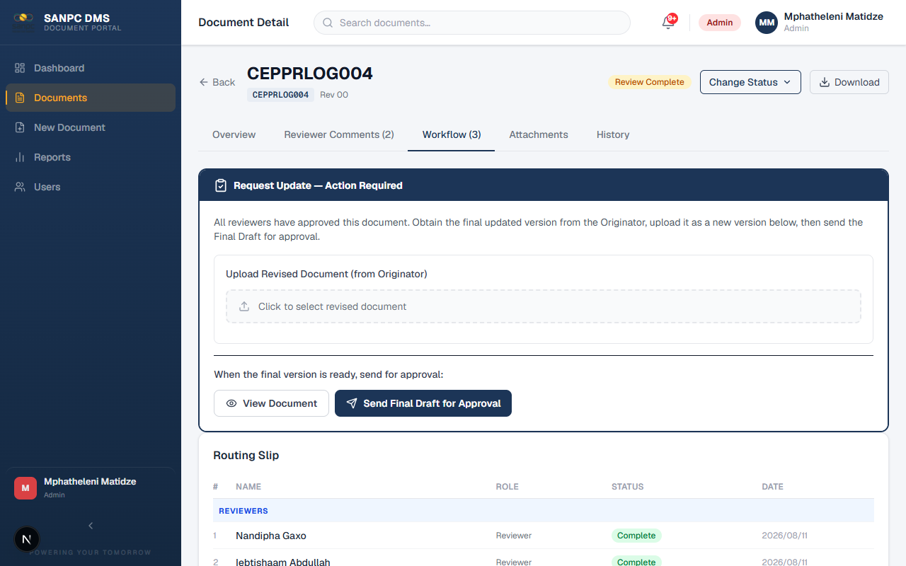
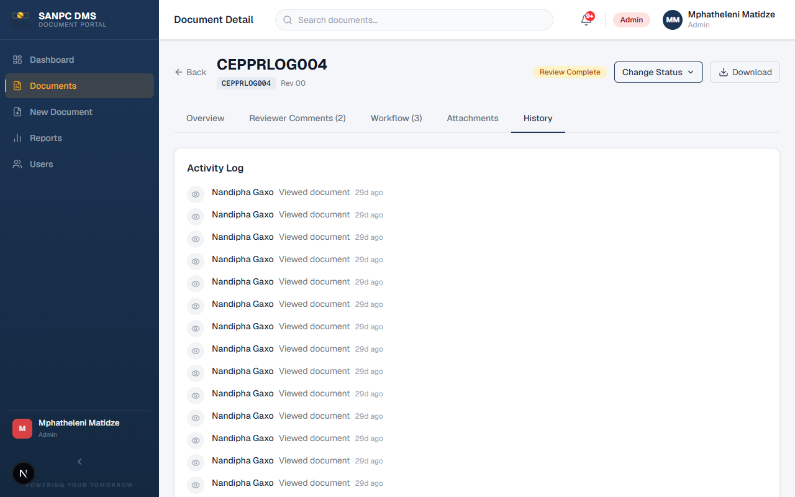
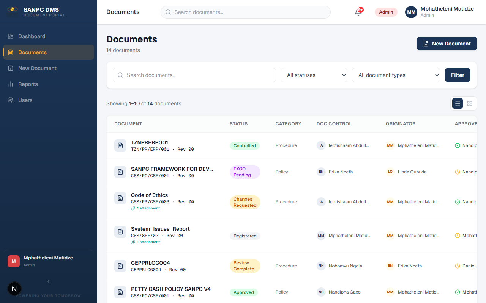
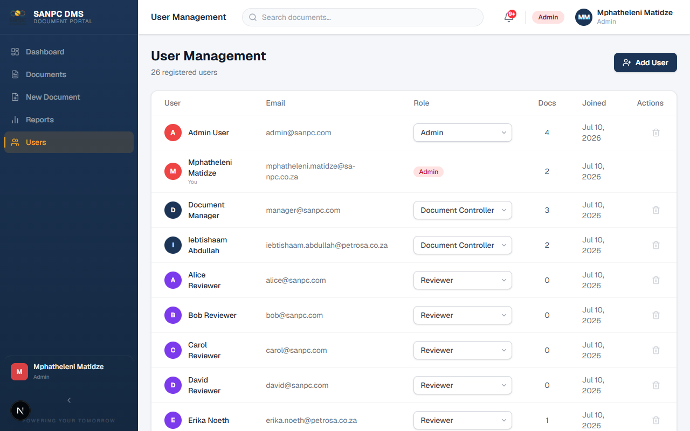
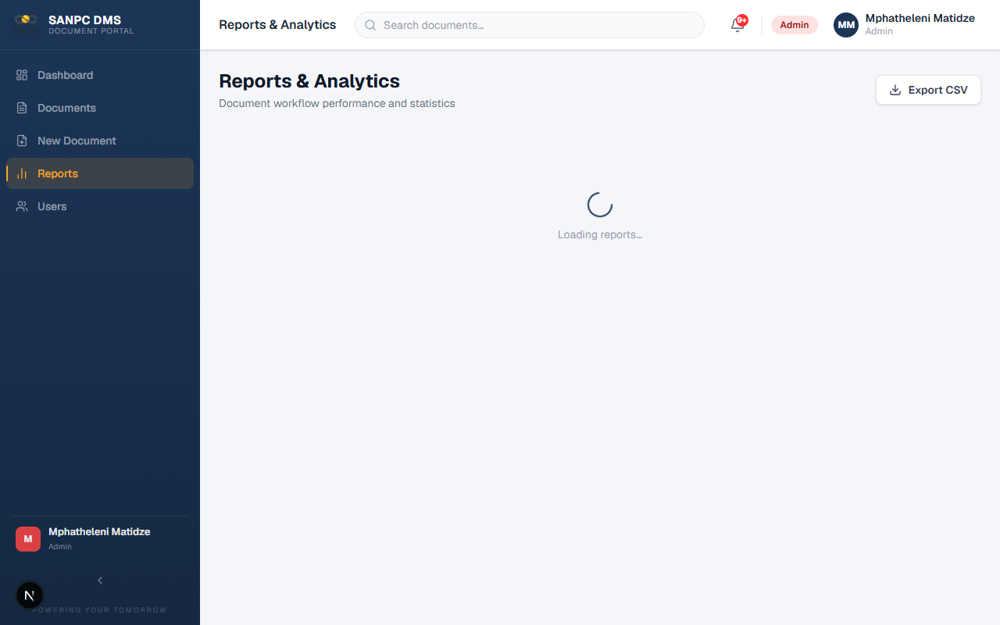

# SANPC Document Management System
## User Training Manual

**Document Number:** DMS-TM-001
**Revision:** 00
**Date:** September 2026
**Classification:** Internal Use
**Prepared by:** ICT Department
**Authorised by:** Document Controller

---

## Table of Contents

1. [Introduction](#1-introduction)
2. [System Overview](#2-system-overview)
3. [Getting Started — Logging In](#3-getting-started--logging-in)
4. [Understanding Your Dashboard](#4-understanding-your-dashboard)
5. [User Roles and What They Can Do](#5-user-roles-and-what-they-can-do)
6. [The Document Lifecycle — How a Document Moves Through the System](#6-the-document-lifecycle)
7. [Role Guide: Document Controller / Document Manager](#7-role-guide-document-controller--document-manager)
8. [Role Guide: Reviewer](#8-role-guide-reviewer)
9. [Role Guide: Approver](#9-role-guide-approver)
10. [Role Guide: Originator](#10-role-guide-originator)
11. [Role Guide: System Administrator](#11-role-guide-system-administrator)
12. [Document Categories and Type Codes](#12-document-categories-and-type-codes)
13. [Document Numbering Convention](#13-document-numbering-convention)
14. [Reports and Analytics](#14-reports-and-analytics)
15. [Notifications and Email Links](#15-notifications-and-email-links)
16. [Frequently Asked Questions](#16-frequently-asked-questions)
17. [Glossary](#17-glossary)

---

## 1. Introduction

### 1.1 Purpose of This Manual

This manual is designed to help all SANPC staff understand and use the **SANPC Document Management System (DMS)**. Whether you are uploading a new policy document, reviewing a procedure, approving a strategy document, or simply searching for a controlled document, this manual walks you through every step.

### 1.2 About SANPC DMS

The SANPC Document Management System is the organisation's official platform for:

- Creating, registering, and storing all controlled documents
- Managing the review and approval process for policies, procedures, and related documents
- Ensuring all documents are properly authorised before release
- Providing a full audit trail of every action taken on every document
- Maintaining retention schedules in line with governance requirements

The system enforces SANPC's internal document control policy (ref: CSS/PR/CSF/005) and ensures that only properly reviewed and approved documents reach "CONTROLLED" status and are made available to staff.

### 1.3 Scope

This manual covers the following system features:

- Login and navigation
- Creating and uploading documents
- Submitting documents for review
- Performing reviews (for Reviewers)
- Performing approvals (for Approvers)
- Releasing controlled documents
- Managing users (for Administrators)
- Viewing reports

### 1.4 Who Should Read This Manual

| Section | Target Audience |
|---|---|
| Sections 1–6 | All users |
| Section 7 | Document Controllers / Document Managers |
| Section 8 | Reviewers |
| Section 9 | Approvers |
| Section 10 | Originators |
| Section 11 | System Administrators |
| Sections 12–17 | All users (reference) |

---

## 2. System Overview

### 2.1 What the System Does

SANPC DMS provides a structured end-to-end process for document lifecycle management:

```
Document Created → Review → Approval → Board/EXCO (if Policy) → Controlled Release
```

Every step is logged, every decision is recorded, and email notifications keep all stakeholders informed automatically.

### 2.2 Supported Document Types

The system manages 17 types of documents used at SANPC:

| Code | Document Type |
|---|---|
| PO | Policy |
| PR | Procedure |
| WP | Work Practice |
| WI | Work Instruction |
| ST | Standard |
| RM | Risk Matrix |
| SD | Strategy & Planning |
| GL | Guidelines |
| TR | Training Material |
| TS | Test Script |
| PF | Process Flow |
| F | Form / Template |
| COG | Corporate Governance |
| SP | Internal Specification |
| BC | Business Continuity Plan |
| TOR | Terms of Reference |
| MSM | Management System Manual |

### 2.3 Key Principles

1. **No document is released without review and approval.** Every document must go through at least one reviewer and one approver before becoming controlled.
2. **Every action is audited.** The system records who did what and when.
3. **Email notifications keep the process moving.** Reviewers and approvers are notified automatically; they can act directly from their email.
4. **Superseded documents are preserved.** When a new version of a controlled document is released, the old version is archived (not deleted).
5. **Policy documents require Board/EXCO resolution.** A special additional step applies to all Policy (PO) documents.

---

## 3. Getting Started — Logging In

### 3.1 Accessing the System

Open your web browser and navigate to the SANPC DMS URL provided by ICT. The system works on all modern browsers (Chrome, Edge, Firefox, Safari).

### 3.2 Login Options


*Figure 1 — The SANPC DMS login screen*

You will see the login page with the following option:

**Log in with your SANPC account (Microsoft / Entra ID)**
1. Click **"Continue with Microsoft"**
2. You will be redirected to Microsoft's login page
3. Enter your SANPC email and password as normal
4. You will be redirected back to the DMS dashboard

> **Note:** If you cannot log in, contact the System Administrator. Do not share your password with anyone.

### 3.3 Logging Out

Click your name or profile icon in the top-right corner of the screen, then click **"Log Out"**. You will be returned to the login page.

> **Security Tip:** Always log out when you finish working, especially on shared computers.

---

## 4. Understanding Your Dashboard

After logging in, you will see your personalised dashboard. What you see depends on your role.


*Figure 2 — The SANPC DMS dashboard showing stats cards, status chart, and pending actions*

### 4.1 Dashboard Sections

**Greeting Banner**
A personalised greeting based on time of day ("Good Morning", "Good Afternoon", or "Good Evening") with your name.

**Stats Cards (top row)**
Quick summary numbers relevant to your role, such as:
- Total documents in the system
- Documents currently in review
- Documents pending your action
- SLA compliance rate

**Status Distribution Chart**
A visual breakdown of all documents by their current status (Draft, In Review, Approved, Controlled, etc.).

**Recent Documents**
A quick list of the most recently active documents, with their status and upload date.

**Pending Actions (your role-specific queue)**
- **Reviewers:** Documents waiting for your review decision
- **Approvers:** Documents waiting for your approval
- **Document Controllers:** Documents in progress that need your attention
- **Administrators:** All active workflows

**Completed Reviews**
For reviewers and approvers — a history of decisions you have already made.


*Figure 3 — Dashboard document status distribution chart and "Needs Your Attention" panel*

### 4.2 Sidebar Navigation

The left sidebar contains your navigation menu. Menu items vary by role:

| Menu Item | Who Sees It |
|---|---|
| Dashboard | All users |
| Documents | All users |
| New Document | Document Controller, Admin |
| Reports | Document Controller, Admin |
| Users (Admin) | Admin only |

---

## 5. User Roles and What They Can Do

### 5.1 Role Overview

The system has five roles. Each person is assigned one role by the System Administrator.

---

### Role: ADMIN (System Administrator)

**Responsibilities:** Full system control, user management, system configuration

**Can do everything in the system, including:**
- Create, edit, and manage all documents
- Create, edit, and delete user accounts
- Assign roles to users
- Configure mandatory reviewers per document type
- Replace or remove reviewers mid-workflow
- View all documents including superseded/archived versions
- Access all reports
- Act as a reviewer or approver on any document

---

### Role: DOCUMENT_MANAGER (Document Controller)

**Responsibilities:** Managing the full document lifecycle

**Key capabilities:**
- Upload and create new documents
- Submit documents for review
- Advance documents from review to approval
- Upload signed pages and attachments
- Upload EXCO/Board resolutions
- Release documents to CONTROLLED status
- Replace reviewers (before Final Draft stage)
- View all documents including superseded versions
- Access reports and export data

**Cannot do:**
- Manage user accounts

---

### Role: REVIEWER

**Responsibilities:** Reviewing documents assigned to them and making review decisions

**Key capabilities:**
- View documents assigned to them for review
- Approve, reject, or request changes on documents
- Leave comments on documents
- Access documents via email links (no login required for email token links)

**Cannot do:**
- Upload documents
- Submit documents for review
- Access admin or reports sections

---

### Role: APPROVER

**Responsibilities:** Final approval of documents after successful review

**Key capabilities:**
- View documents assigned to them for approval
- Approve or reject documents
- Leave comments on documents
- Also participate as reviewers when assigned

**Cannot do:**
- Upload documents
- Submit documents
- Access admin or reports sections

---

### Role: ORIGINATOR

**Responsibilities:** Read-only tracking and reference role

**Key capabilities:**
- View documents that they originated
- Track the progress of their documents through the workflow

**Cannot do:**
- Submit, approve, or take any workflow action
- Upload documents
- Access admin, reports, or other users' documents

---

## 6. The Document Lifecycle

Understanding how a document moves through the system is essential for all users.

### 6.1 Document Status Flow

```
REGISTERED
    │
    ▼
DRAFT ──────────────────────────────────────────────┐
    │                                               │
    ▼ (Submit for Review)                           │
IN_REVIEW ◄────────────────────────────────────────┐│
    │                                              ││
    ▼ (All reviews complete)                       ││
REVIEW_COMPLETE                                    ││
    │                                              ││
    ▼ (Document Controller advances)               ││
FINAL_DRAFT / PENDING_APPROVAL                     ││
    │                                              ││
    ▼ (All approvers approve)                      ││ EXIT  D
APPROVED ──► CHANGES_REQUESTED ────────────────────┘│
    │                                               │
    │ (Policy documents only)                       │
    ▼                                               │
EXCO_PENDING (upload Board resolution)             │
    │                                               │
    ▼                                               │
CONTROLLED ◄──────────────────────────────────────┘
    │
    ▼ (when new version is released)
SUPERSEDED
```

**Additional status paths:**
- Any document can be **CANCELLED** at most stages
- **REJECTED** documents can be resubmitted as new versions
- **UPDATING** — intermediate state when changes are being made after review

### 6.2 Status Descriptions

| Status | Meaning |
|---|---|
| REGISTERED | Document has been created and saved but not yet submitted |
| DRAFT | Document is being prepared |
| IN_REVIEW | Reviewers have been notified and are working on their reviews |
| UPDATING | Reviews are done; document controller or originator may update file |
| REVIEW_COMPLETE | All reviewers have completed — waiting for Document Controller to advance |
| FINAL_DRAFT | Document is ready for approver review |
| PENDING_APPROVAL | Approvers have been formally activated |
| APPROVED | All approvers have approved |
| EXCO_PENDING | Awaiting Board/EXCO resolution (Policy documents only) |
| CONTROLLED | Document is officially released and in effect |
| SUPERSEDED | Replaced by a newer controlled version |
| CHANGES_REQUESTED | A reviewer/approver has requested changes — returned to originator |
| REJECTED | Document has been formally rejected |
| CANCELLED | Document workflow has been cancelled |

---

## 7. Role Guide: Document Controller / Document Manager

This section is for users with the **DOCUMENT_MANAGER** or **ADMIN** role.

### 7.1 Creating a New Document

**Step 1: Start the Upload Wizard**
1. Click **"New Document"** in the left sidebar
2. The 3-step wizard opens


*Figure 4 — New Document wizard: Step 1 — upload your Word document*

**Step 2: Upload the File**
1. Drag and drop your file onto the upload area, or click to browse
2. Supported formats: Word (.docx), Excel (.xlsx), PDF (.pdf), and others
3. The system will upload the file to SharePoint (or local storage if SharePoint is not configured)
4. Wait for the green "Upload complete" indicator before proceeding
5. Click **"Next"**

**Step 3: Fill in Document Metadata**

Fill in all required fields:

| Field | Description | Required? |
|---|---|---|
| Title | Full document title | Yes |
| Description | Brief description of the document's purpose | Yes |
| Category | Select from the 17 document types | Yes |
| Document Number | Unique identifier (e.g., PO-001-2026). Use "Get Next Number" to auto-generate | Yes |
| Revision | Version revision code (e.g., "00" for new, "01" for first revision) | Yes |
| Originator | The person/department originating this document | Yes |
| Authorised By | The person who authorises this document type | Yes |
| Purpose | Brief statement of the document's purpose | No |
| Original Date | The original creation date of the document | No |
| Next Review Date | When this document should next be reviewed | No |
| Tags | Keywords for searching (optional) | No |

Click **"Next"** when done.

**Step 4: Configure the Workflow**

1. **Reviewers:** Add the people who must review this document
   - Type a name to search for users
   - Mandatory reviewers for this document type will be pre-loaded automatically
   - You can add additional reviewers
   - Order them by dragging if a specific sequence is needed

2. **Approvers:** Add the people who must formally approve this document
   - At least one approver is required

3. **Review Deadline:** Set the deadline by which reviewers must complete their review
   - The minimum is 21 days (regulatory requirement)
   - The date cannot be set to less than 21 days from today

4. **EXCO Required:** For Policy (PO) documents, this is automatically enabled

5. Click **"Submit"** or **"Save as Draft"**

> **Tip:** Saved drafts appear in the document list with REGISTERED status. You can return to submit them later.

---

### 7.2 Submitting a Document for Review

If you saved the document as a draft, or need to resubmit after changes:

1. Open the document from the Documents list
2. In the right-side Review Panel, click **"Submit for Review"**
3. Confirm the action in the dialog
4. The system will:
   - Notify all reviewers by email with a direct review link
   - Set the deadline countdown
   - Change the document status to **IN_REVIEW**

---

### 7.3 Monitoring Review Progress


*Figure 8 — Document detail page showing file preview, document metadata, and status*


*Figure 9 — Workflow tab showing the routing slip: reviewers, approvers, their status and completion dates*


*Figure 10 — History tab showing the full activity audit log for a document*

On the document detail page, the **Review Panel** shows:
- Each reviewer's name and current status (Pending, In Progress, Approved, Changes Requested, Rejected)
- The deadline date
- Whether the deadline has passed (shown in red)

You can also see all reviewer comments in the **Comments** section below.

---

### 7.4 Replacing or Removing a Reviewer

If a reviewer is unavailable or needs to be changed:

1. Open the document detail page
2. Find the reviewer in the Review Panel
3. Click the **"Replace"** button next to their name
4. Search for and select the new reviewer
5. Confirm the replacement

> **Note:** Reviewer replacement is blocked after the document reaches FINAL_DRAFT stage. Contact the Administrator if replacement is needed after that point.

To remove a reviewer entirely:
1. Click **"Remove"** next to their name
2. The reviewer is removed but an audit record is preserved

---

### 7.5 Advancing to Approval

Once all reviewers have completed their reviews:
1. The document status changes to **REVIEW_COMPLETE**
2. Open the document and click **"Advance to Approval"** in the Review Panel
3. The system activates all approvers and sends them email notifications
4. Document status changes to **PENDING_APPROVAL**

---

### 7.6 Releasing a Controlled Document (Non-Policy)

Once all approvers have approved:
1. Document status is **APPROVED**
2. Open the document
3. In the Review Panel, click **"Mark as Controlled"**
4. Confirm the action
5. The system will:
   - Change status to **CONTROLLED**
   - Automatically find any previous controlled version of the same document number and mark it **SUPERSEDED**
   - Record the controlled date and set the 40-year retention date

---

### 7.7 Releasing a Policy Document (EXCO Process)

Policy documents (type code: PO) require Board/EXCO resolution before being controlled.

**After all approvers approve (status = APPROVED):**

1. Open the document
2. Click **"Submit to EXCO"** in the Review Panel
3. Status changes to **EXCO_PENDING**

**After the Board meeting:**

1. Open the document
2. In the Attachments section, upload the Board/EXCO resolution document
3. Fill in the Resolution Number and Resolution Date (optional but recommended)
4. Click **"Record Resolution & Control"**
5. Status changes to **CONTROLLED**

---

### 7.8 Uploading a Signed Page

After a document is APPROVED or CONTROLLED, you can upload the signed physical page:

1. Open the document
2. Scroll to the **Attachments** section
3. Click **"Upload Signed Page"**
4. Select the scanned PDF of the signed page
5. The signed page is now stored and linked to the document

---

### 7.9 Amending a Document File

If corrections to the file are needed before approval is complete:

1. Open the document
2. Click **"Amend File"** in the Review Panel
3. Upload the corrected file
4. The amendment is logged in the Version History
5. Reviewers and approvers will see the updated file

> **When can you amend?** You can amend the file when the document is in FINAL_DRAFT, PENDING_APPROVAL, REJECTED, or CHANGES_REQUESTED status.

---

## 8. Role Guide: Reviewer

This section is for users with the **REVIEWER** role.

### 8.1 How You Will Be Notified

When a document is submitted for review and you are assigned as a reviewer, you will receive an email notification. The email will contain:
- The document title and number
- A link to view the document
- The deadline by which you must complete your review
- **Two buttons: "Approve" and "Request Changes"** (for quick action directly from email)

### 8.2 Accessing Documents for Review

**Option A — Via Email Link**
1. Click the review link in your email
2. You will be taken directly to the review page — **no login is required**
3. You can view the document and submit your decision

**Option B — Via the DMS Portal**
1. Log in to the DMS
2. Go to **Dashboard** — your pending reviews appear in the "Pending Actions" section
3. Or go to **Documents** and filter by your assigned reviews

### 8.3 Reviewing a Document

On the document review page, you will see:

- **Document Viewer** — view the document directly in the browser (PDF, Word, Excel)
- **Document Metadata** — title, number, category, description, originator
- **Comments** — any comments from the document controller or other reviewers
- **Your Review Decision Panel** (on the right)

**To submit your review:**

1. Read the document in the viewer
2. In the Review Panel, select your decision:
   - **Approve** — you are satisfied the document is correct
   - **Request Changes** — you have specific changes that must be made before approval
   - **Reject** — the document should not proceed in its current form
3. Add your comment in the **Comments** field:
   - If approving: a comment is optional ("No comment" will be recorded if left blank)
   - If requesting changes or rejecting: please provide a clear description of the issue
4. Click **"Submit Decision"**

### 8.4 What Happens After Your Decision

| Your Decision | What Happens |
|---|---|
| Approve | Your review is marked complete. Other reviewers continue in parallel. When all reviewers approve, the document advances. |
| Request Changes | All other reviews are paused. The document is returned to the Document Controller with your comments. |
| Reject | All other reviews are halted. The Document Controller is notified. The document may be resubmitted as a new version. |

### 8.5 If You Have Already Reviewed

If you click an email link for a review you have already completed, the system will show you a message indicating your decision has been recorded. You cannot change a submitted review decision.

---

## 9. Role Guide: Approver

This section is for users with the **APPROVER** role.

### 9.1 How You Will Be Notified

You will receive two types of email notifications:

1. **Heads-Up Email** — sent when reviewers are first activated. This gives you advance notice that the document is coming your way.
2. **Approval Request Email** — sent when it is your turn to formally approve. Contains direct Approve/Reject buttons.

### 9.2 Reviewing the Document for Approval

When you receive the approval request email:
1. Click the **"View Document"** link or the **"Approve"** / **"Reject"** button in the email
2. The system takes you to the document (no login required if using the email link)
3. Review the full document and all metadata
4. Check the reviewer comments if any were made

### 9.3 Making Your Approval Decision

In the Approval Panel:

1. Select your decision:
   - **Approve** — you formally approve this document for release
   - **Reject** — you reject this document; provide a clear reason
2. Add your comment (required for rejections; optional for approvals)
3. Click **"Submit Decision"**

> **Important:** Your approval is a formal record. Ensure you have fully read the document before approving.

### 9.4 Outcome After Your Decision

| Your Decision | What Happens |
|---|---|
| Approve (and all others also approve) | Document advances to APPROVED status. Document Controller is notified to release it. |
| Approve (but others still pending) | Your approval is recorded. Other approvers continue. |
| Reject | All other approvals are halted. The document returns to the Document Controller. |

---

## 10. Role Guide: Originator

This section is for users with the **ORIGINATOR** role.

### 10.1 What You Can See

As an Originator, you can:
- View all documents where you are listed as the Originator
- See the current status of each document
- Read comments and activity history
- View the document file

### 10.2 What You Cannot Do

Originators have read-only access. You cannot:
- Submit documents for review
- Make review or approval decisions
- Upload or amend files

If you need to make changes to a document, contact your Document Controller.

### 10.3 Tracking Your Documents


*Figure 11 — The Documents list page with search, status filter, document type filter, and all documents visible*

1. Log in and go to **Documents**
2. All documents where you are listed as Originator will be visible
3. Use the status filter to see documents in specific stages

---

## 11. Role Guide: System Administrator

This section is for users with the **ADMIN** role. Administrators have all the Document Controller capabilities plus the following.

### 11.1 User Management


*Figure 6 — Admin: User Management page showing all registered users with roles and document counts*

**To view all users:**
1. Click **"Users"** or **"Admin"** in the left sidebar
2. The user list shows all registered users with their roles, email addresses, and document counts

**To create a new user:**
1. Click **"New User"** or the **"+"** button
2. Fill in:
   - Full Name
   - Email Address
   - Role (Admin, Document Manager, Reviewer, Approver, Originator)
   - Department Role (optional — informational field for display)
   - Password (set an initial password; user should change it at first login)
3. Click **"Create User"**

**To edit a user:**
1. Click on the user's name or the edit icon
2. Update their name, role, or department role
3. Click **"Save"**

**To delete a user:**
1. Click the delete icon next to the user
2. Confirm the deletion
3. The user account is removed. Documents they created remain in the system.

> **Warning:** Deleting a user who has active review assignments may affect ongoing workflows. Ensure they are replaced on all active documents first.

---

### 11.2 Configuring Mandatory Reviewers

Mandatory reviewers are automatically added to every document of a specific type. For example, the Compliance Officer might be a mandatory reviewer on all Policy documents.

**To configure mandatory reviewers:**
1. In the Admin panel, find the **"Mandatory Reviewers"** section
2. Select the **Document Type** from the dropdown
3. Search for and select the user to make mandatory for that type
4. Click **"Add"**
5. To remove, click the **"Remove"** button next to the assignment

> **Effect:** When a Document Controller creates a new document of that type, this reviewer is automatically pre-loaded in the reviewer list.

---

### 11.3 Replacing Reviewers Mid-Workflow

As Admin, you can replace any reviewer at any stage:
1. Open the document
2. Find the reviewer in the Review Panel
3. Click **"Replace"**
4. Select the replacement user
5. The new reviewer receives an email notification

---

## 12. Document Categories and Type Codes

The following table shows all document types supported in the system, their codes, and brief descriptions.

| Code | Category | Description |
|---|---|---|
| PO | Policy | Organisational policies. Requires Board/EXCO resolution before release. |
| PR | Procedure | Step-by-step procedures for how tasks are performed. |
| WP | Work Practice | Best practice guidelines for performing specific work. |
| WI | Work Instruction | Detailed instructions for a specific task or operation. |
| ST | Standard | Technical standards and specifications. |
| RM | Risk Matrix | Risk assessment and management matrices. |
| SD | Strategy & Planning | Strategic plans and planning documents. |
| GL | Guidelines | Guidance documents and advisory content. |
| TR | Training Material | Training materials, courses, and learning content. |
| TS | Test Script | Test plans, test scripts, and quality assurance documents. |
| PF | Process Flow | Process flow diagrams and workflow documentation. |
| F | Form/Template | Blank forms and reusable templates. |
| COG | Corporate Governance | Corporate governance documents and charters. |
| SP | Internal Specification | Internal technical or operational specifications. |
| BC | Business Continuity Plan | Business continuity and disaster recovery plans. |
| TOR | Terms of Reference | Terms of reference for committees and working groups. |
| MSM | Management System Manual | Management system manuals and handbooks. |

---

## 13. Document Numbering Convention

### 13.1 Format

Document numbers follow the format:

```
[TYPE CODE]-[SEQUENCE NUMBER]-[YEAR]
```

**Examples:**
- `PO-001-2026` — First Policy document created in 2026
- `PR-005-2026` — Fifth Procedure document created in 2026
- `TR-012-2025` — Twelfth Training Material created in 2025

### 13.2 Auto-Generation

When creating a new document, click **"Get Next Number"** to auto-generate the next available number for the selected document type and current year.

### 13.3 Revision Numbers

- New documents start at revision **"00"**
- First revision after release: **"01"**
- Second revision: **"02"** — and so on

The revision number is manually set by the Document Controller when creating the document.

---

## 14. Reports and Analytics

Reports are available to **Document Controllers** and **Administrators** only.

### 14.1 Accessing Reports

Click **"Reports"** in the left sidebar.


*Figure 7 — Reports and analytics page with status distribution and SLA metrics*

### 14.2 Available Reports

**Document Status Distribution**
A chart showing how many documents are in each status. Useful for understanding the overall pipeline load.

**Review SLA Analytics**
- Average time to complete a review
- Percentage of reviews completed on time vs overdue
- SLA compliance rate

**Rejection Rate**
Percentage of documents that were rejected at the review or approval stage.

**Average Review Time**
How long, on average, it takes from submission to completion of all reviews.

### 14.3 Exporting Data

Click **"Export to CSV"** to download a full data export of all documents, including their metadata, status, dates, and reviewer information. This can be opened in Microsoft Excel for further analysis.

---

## 15. Notifications and Email Links

### 15.1 In-System Notifications

The bell icon in the top navigation bar shows your unread notifications. Click it to see all notifications, including:
- Documents assigned to you for review or approval
- Updates on documents you created or follow
- System alerts

Click **"Mark as Read"** or click the notification to go to the relevant document.

### 15.2 Email Notifications

The system sends automated emails for key events:

| Email Type | Sent To | When Triggered |
|---|---|---|
| Review Assignment | All assigned Reviewers | When document is submitted for review |
| Heads-Up | All assigned Approvers | When review stage begins (advance notice) |
| Document Controller Notification | Document Controller | When workflow starts |
| Review Complete | Document Controller | When all reviews are done |
| Approval Request | All assigned Approvers | When advanced to approval stage |
| Approved/Rejected | Originator & Document Controller | When final approval decision is made |
| Reminder | Reviewers with pending reviews | After 18 days without action |

### 15.3 Acting Directly from Email

Reviewer and approver emails contain action buttons. You can:
- Click **"Approve"** in the email to directly record your approval — no login required
- Click **"Request Changes"** to flag the document for revision
- Click **"View Document"** to open the full document in the browser

> **Security Note:** Email review links are unique and expire once used or when the document moves to a new stage. If a link does not work, log in to the DMS directly.

---

## 16. Frequently Asked Questions

**Q: I cannot log in. What should I do?**
A: Check that you are using the correct email address. If you are using your Microsoft account, make sure you are signing in with your SANPC email. If using a local password, contact the System Administrator to reset your password.

---

**Q: I received a review email but the document is already marked as completed. Why?**
A: Another reviewer may have requested changes or rejected the document, which paused or ended your review. Log in to the DMS to see the current status. Or the document may have been resubmitted — your link is for the previous submission only.

---

**Q: I accidentally approved a document. Can I undo it?**
A: Decisions cannot be reversed directly by the reviewer. Contact your Document Controller or System Administrator, who can replace your reviewer slot and re-activate the review.

---

**Q: Can I see documents that I am not assigned to?**
A: It depends on your role. Reviewers and Approvers can only see documents they are assigned to or that they originated. Document Controllers and Admins can see all documents.

---

**Q: Why can I not see certain documents that I know exist?**
A: The document may have been SUPERSEDED (replaced by a newer version). Superseded documents are hidden from Reviewers and Approvers. Contact your Document Controller to access superseded documents.

---

**Q: How do I know when my review is due?**
A: The deadline is shown in the Review Panel on the document page and in the original email notification. If you are approaching the deadline, a reminder email will be sent at 18 days.

---

**Q: A colleague left the organisation and they are assigned as a reviewer. What happens?**
A: The Document Controller or Administrator can replace that reviewer. The new reviewer will receive a notification to complete the review.

---

**Q: Why does my Policy document have an extra step after approval?**
A: Policy documents (type code PO) require a Board/EXCO resolution before they can be released to CONTROLLED status. This is a governance requirement. The Document Controller will upload the resolution document after the Board meeting.

---

**Q: Can I upload multiple files for one document?**
A: The main document is a single file. However, you can upload additional supporting files as Attachments (available after APPROVED status) — such as signed pages, Board resolutions, or supplementary materials.

---

**Q: How long are documents kept in the system?**
A: Controlled documents have a 40-year retention period from the date they were released. Superseded documents are retained as an archive. The system records the Retention Date automatically.

---

## 17. Glossary

| Term | Definition |
|---|---|
| Controlled Document | A document that has completed the full review, approval, and release process and is now officially in effect |
| Document Controller | The person responsible for managing document workflows; also called Document Manager |
| Document Number | A unique identifier assigned to a document following the SANPC naming convention |
| EXCO | Executive Committee — the governing body whose resolution is required for Policy documents |
| Mandatory Reviewer | A user automatically added as a reviewer for a specific document type, configured by the Administrator |
| Originator | The person or department that created or owns the document (not necessarily the person who uploaded it to the system) |
| Retention Date | The date after which a document may be disposed of, calculated automatically as 40 years from the controlled date |
| Revision | The version iteration of a document (00, 01, 02, etc.) |
| SLA | Service Level Agreement — the agreed timeframe within which a review must be completed (minimum 21 days) |
| Superseded | A document replaced by a newer controlled version; still accessible by Document Controllers and Admins for reference |
| Token Link | A unique, secure link embedded in emails allowing reviewers to take action without logging in |
| Workflow | The sequence of steps a document follows from creation to controlled release |

---

## Appendix A: Quick Reference Card

### For Reviewers
1. Check email for review request
2. Click the review link
3. Read the document
4. Click Approve, Request Changes, or Reject
5. Add a comment if needed
6. Submit

### For Approvers
1. Check email for approval request
2. Click the approval link
3. Read the document and reviewer comments
4. Click Approve or Reject
5. Add a comment
6. Submit

### For Document Controllers
1. Upload file → Fill metadata → Set reviewers/approvers → Submit
2. Monitor review progress on document detail page
3. When REVIEW_COMPLETE → Click "Advance to Approval"
4. When APPROVED → Click "Mark as Controlled" (or EXCO process for policies)

---

## Appendix B: Document Workflow Decision Tree

```
Is this a Policy document (PO)?
    │
    ├─ YES → After approval, submit to EXCO
    │         Upload Board resolution
    │         Release to CONTROLLED
    │
    └─ NO  → After approval, release directly to CONTROLLED
              System auto-supersedes previous version
```

---

*End of Training Manual*

---

**Document Control Information**

| Field | Value |
|---|---|
| Document Number | DMS-TM-001 |
| Revision | 00 |
| Status | DRAFT |
| Date | September 2026 |
| Author | ICT Department |
| Review Date | September 2027 |

*This document is subject to SANPC document control procedures. Ensure you have the current version before use.*
